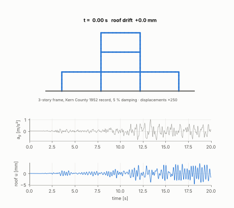
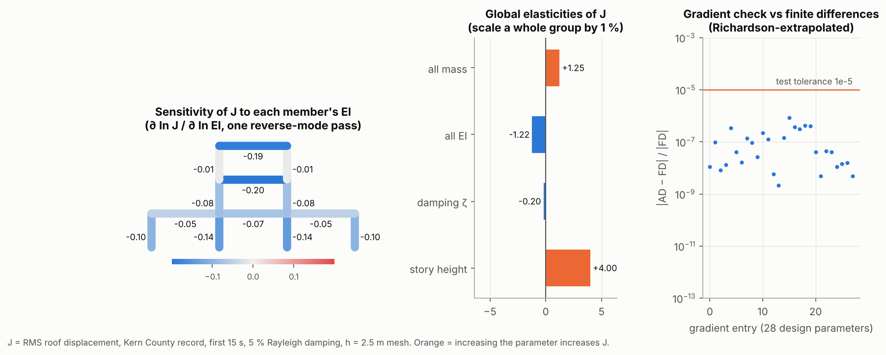

# NumericalAlgorithms4StructuralDynamics
Gaoyuan Wu's APC523 Final Project, now with a **differentiable JAX solver** (`structdyn_jax/`).



## What's new: `structdyn_jax` (branch `jax-migration`)

A JAX port of the original NumPy solver. It keeps the same frame FEM, meshing,
boundary conditions, and the four time integrators (Newmark-β, Wilson-θ, Bathe, SSP-RK3),
and adds **gradients**:

* **Forward:** reproduces the original solver to ≤ 1e-9 of peak (1.5e-13 in practice). It also agrees with
  the open-source FEM code [PyNite](https://github.com/JWock82/Pynite): matrices, static deflections,
  natural frequencies (1e-8), and earthquake time histories (0.09 % of peak vs an exact modal solution).
* **Backward:** `jax.grad` / `jax.jvp` of any response w.r.t. member stiffness, mass, damping, or nodal
  coordinates. Checked against finite differences for all 28 design parameters and 4 integrators.

```python
import jax, structdyn_jax as sj
from structdyn_jax.problems import EarthquakeProblem, zero_params

prob = EarthquakeProblem(h_mesh=2.5, duration=15.0)    # legacy 3-story frame, Kern County record
p = zero_params()                                       # log-scale design factors (0 = original design)
J, dJ = jax.value_and_grad(prob.rms_roof)(p)            # RMS roof drift and its gradient, one reverse pass
```

Lower-level API: `frame.matrices(m, E, A, I)` returns `(K, M)`; `sj.newmark(K, M, C, load, u0, v0, h, N)`;
`sj.ground_motion_load(M, frame.influence(0), record, dt)`.



| | |
|---|---|
| [`docs/VERIFICATION.md`](docs/VERIFICATION.md) | every check, the numbers, and **legacy quirks found during the port** |
| [`tests/`](tests) | 43 tests: legacy parity, PyNite, SAP2000, SDOF closed form, gradient vs finite differences |
| [`scripts/make_figures.py`](scripts/make_figures.py) | regenerates all figures in `docs/figures/` |
| [`agentic-demo/`](agentic-demo/README.md) | workshop write-up: how this migration was done with an AI agent, and which prompts helped |

```bash
pip install -r requirements.txt
```

```bash
pytest
```

```bash
python scripts/make_figures.py
```

Tests run on every push via GitHub Actions (`.github/workflows/tests.yml`).

---

# Original project documentation (2021, NumPy version)

## Introduction
This solver is cabaple of solving structural dynamics problem for 2D frame system. The input can be continuous function or discrete data points such as ground motion records.
For spatial discretizatioin, lumped-mass method and finite-element-method can be used.
For time integration, there are 4 methods to choose from:
1. Strong-stability-preserving Runge-Kutta(3 stage, 3^rd order)
2. Wilson-theta method
3. Newmark-beta method
4. Bathe method (first stage at t + 0.5h)


## Usage
This solver is tested with Python 3.7.
Numpy is needed to implement this solver.

### Initial structure and 1D mesh
First, import the package `get1DMesh.py` as `mesh`.
Then, specify the initial structural shape by constructing a 2D array `Ini_nodecoord` representing the nodes' coordinates and another 2D array
`B` for connectivity matix. `h` is the int object for the mesh size.
Each row of `Ini_nodecoord` represents each node, where the first column stands for x-coordinate and the second is for y-coordinate.
Each row of `B` represents each element, where the first column is for the starting node index, and the secon is end node index. The entry in `B` is in physical sense (starts from 1, not zero).  
`mesh.get1DMesh(Ini_nodecoord,B,h)` returns:
1. `New_coord`, 2D array
2. `New_B`, 2D array
3. `Ini_to_new`, 2D array, the first column for old/original node, the second for new node index
4. `Ini_to_new_ele`, 2D array, the first for new element index, the second for old element index

### Rendering
Import `getPlot.py` as `render`.
`render.getPlot(coord,B,show_ele_tag = None,show_node_tag = None,tag_size = 5,fig_size = (14,14),tag_marker = 'o')` helps you to generate a plot for any given structure.

### FEM
Import `getMK.py` as `getMK`.
Construct 1D arrays for structural parameters of mass per unit length, Young's modulus, cross sectional area and moment of inertia.
The dimension is the same as element number after mesh.
`getMK_FEM(joint_coord,B,ele_m,ele_E,ele_A,ele_I)` returns
1. Global stiffness matrix, 2D array
2. Global mass matrix, 2D array

### Boundary condions
Import `getBC` as `getBC`.
`bc` is a dictionary storing initial node index and the node's constraints.
key:value -> key is initial node index in python, value is 1 for fixed BC, 2 for pinned and 3 for roller support.
Example:
```python
#Node 1-4 are fixed
bc = {0:1,1:1,2:1,3:1} 
```

`getBC.MK_Reduction(M,K,bc,ini_to_new)` returns:
1. `M_bc,K_bc`, 2D array new mass matrix and stiffness matrix where first `act_num` rows for active dofs.
2. `inact_num`, integer, `act_num` can be obtained by `K_bc.shape[0] - inact_num`
3. `glb_to_bc`, 2D array, represents the transformation from global matrix to matrix afer imposing boundary condtions.


### Time integration
Before implementing the time integration. One needs to define the function for external loading.
For functional input, below is an example:
```python
#Test External loading 1: acting on node 9 (8 in py), postive x direction
def f1(x):
    return 1000
f1_ini_node = 8 #node on which the load applies
f1_dof_index = 0 #0 for x, 1 for y, 2 for rz

def test_f(x,itn = itn,glb_to_bc = glb_to_bc,f = f1,f_ini_node = f1_ini_node,dof_index = f1_dof_index,act_num = act_num):
        f_list = np.array([[f,glb_to_bc[itn[f1_ini_node]*3 + dof_index]]])
        vec = np.zeros(act_num)
        for i in range(f_list.shape[0]):
            pos = f_list[i,1]
            vec[pos] = f_list[i,0](x)
        return vec 

```

For ground motion records, below is an example:

```python
#Test External loading 2: earthquake

GM_tab = pd.read_excel('GM.xlsx')
GM_data = np.array(GM_tab.values) #1D array, acceleration
dt_ft = 0.005 #Time interval of the record

def test_gm(M_a,act_num = act_num,GM_data = GM_data):
        return - M_a @ (np.ones((act_num,1))@(GM_data.T))
    test_f2 = test_gm(M_a)

```

Afterwards, we are ready to implement the the time integration. Import corresponding `.py` file from `TimeIntegration` folder.
Take Newmark-beta method as an example:

```python
# u_0 and v_0 are 1D arrays for inital conditions
# t_a is the starting time
# N,h are number of steps and grid size for time integration
# dt_ft is 0 for functional input, and is identical to the time interval fo ground motion input 

import Newmark as NM
u_t,v_t,a_t = NM.Newmark_beta(delta,beta,K_a,M_a,C_a,test_f2,u_0,v_0,t_a,N,h,dt_ft = 0) # Returns the time-history
```

### Example
To better understand how the solver works, you can run `SDOF.py` and `MDOF_FEM.py` files in `Structure` folder.
Make sure to add you path to the system and replace the corresponding scripts with `sys.path.append('your path/NumericalAlgorithms4StructuralDynamics/Structure'),
sys.path.append('your path/NumericalAlgorithms4StructuralDynamics/TimeIntegration')`
