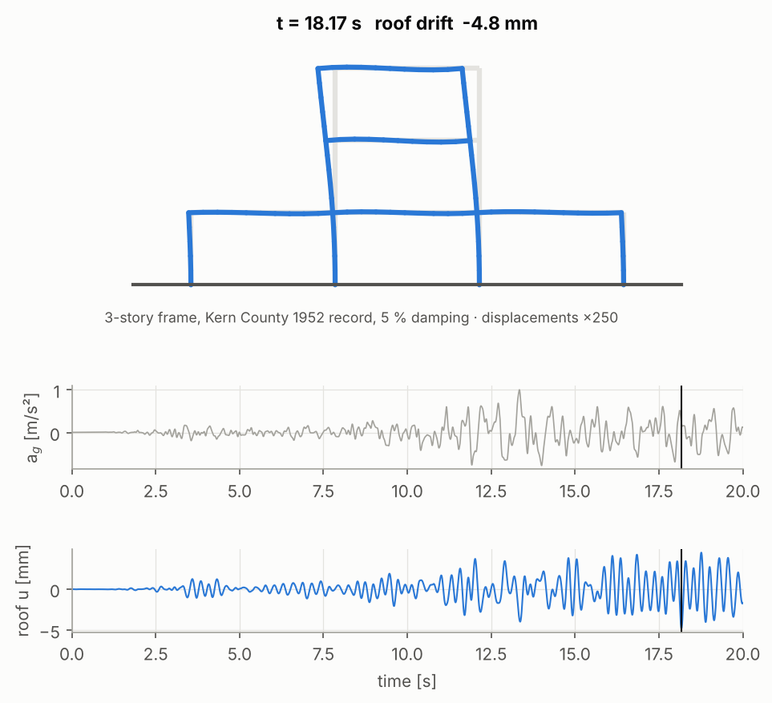
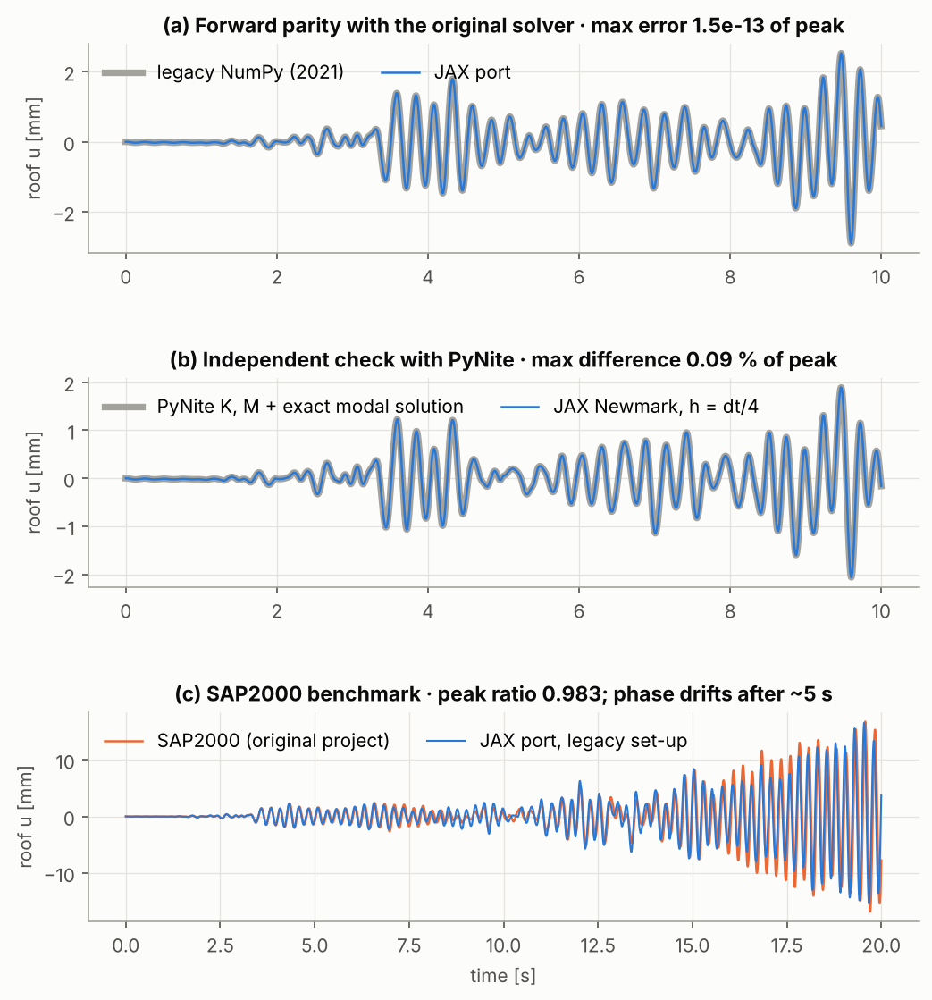

# Demo: turning a 5-year-old NumPy dynamics solver into a verified, differentiable JAX solver

**Researcher:** Gaoyuan Wu · **Tool:** Claude Code (cloud session) · **Model:** _[presenter: fill in]_ · **Work:** November 13, 2026 · **Result:** branch [`jax-migration`](https://github.com/GaoyuanWu/NumericalAlgorithms4StructuralDynamics/tree/jax-migration)

**Task:** port my first-year grad-school course project (2D frame FEM with four time integrators, NumPy, 2021) to JAX. The port had to reproduce the old forward results exactly, add gradients, and prove both with external references. This matters because a differentiable solver enables sensitivity analysis and gradient-based design, but only if I can trust it.

This page follows the actual session. The prompt is quoted verbatim. Results summarize what the agent did and what the tests showed. [Full prompt log and session timeline](PROMPTS.md).

## 1. What I wanted

The old code was plain NumPy: Python loops, Windows paths, no tests, and no gradients. I wanted a JAX version that:

- gives the same answers as the old code;
- is checked against an independent open-source solver;
- gives gradients I can trust;
- shows the structure vibrating under an earthquake.

I supplied the repository, named the references (PyNite, finite differences), and pointed to the PI's demo guidelines. The agent did the reading, porting, testing, debugging, plotting and write-up.

## 2. The original prompt

**Prompt source:** verbatim (single message that started the session)

> Our research group is doing a AI workshop tomorrow where each member uses a demo to demonstrate what is good/bad practice of agentic workflow.
>
> I'd like to use my this final project repo for numerical algorithms class i took in first year grad school from 5 years ago, which is an old, non-differentiable dynamics Python solver of structures.
>
> I'd like to show a demo where I use CLAUDE to adapt it to a jax and differentiable solver, with the exact forward ability, and additional backward capability. With checks against open-source solver PyNite (forward), and gradient check using finite difference. Visuals would be great to show how structures vibrate under ground motions. Open a new branch called jax-migration. Everything tested online.
>
> In addition to **code development**, Review the example and guideline of such demo provided by the PI: "https://github.com/SOLARIS-JHU/solaris-agentic-research", so that this code development procedure becomes a new example by me. Record this session, of what prompts that helped, did not help much.

**Observed result of this first prompt:**

- a new package `structdyn_jax/` with the same mesh, FEM, BCs and four integrators, rewritten as `lax.scan` loops;
- 43 automated tests, run on every push by GitHub Actions;
- the earthquake animation, a verification figure and a sensitivity map;
- a [verification report](https://github.com/GaoyuanWu/NumericalAlgorithms4StructuralDynamics/blob/jax-migration/docs/VERIFICATION.md);
- this page.

The old code is kept untouched and used as the test reference.

([animated version](https://github.com/GaoyuanWu/NumericalAlgorithms4StructuralDynamics/blob/jax-migration/docs/figures/frame_earthquake.gif))

## 3. What the prompt made possible, and where the agent hit judgment calls

The prompt named **external checks** (PyNite for forward, finite differences for backward). The agent therefore treated every mismatch as something to explain, not a tolerance to loosen. Five moments in the session show why that mattered.

### A. "Exact forward" exposed a 2 % mismatch, then a bug in my 2021 code

The first parity run differed from the old solver by 2 %. The agent bisected it to one time step. Inside compiled JAX, `floor(t/dt)` and `mod(t, dt)` disagreed at a sample boundary, so the earthquake record jumped one sample ahead.

While fixing that, it found that **my original code has the same class of bug in plain Python**: `int(t/dt)` and `t % dt` disagree whenever `t/dt` rounds up. That reads the wrong sample at about 5 % of steps, changing the response over the first 5 s by up to **6.7 % of the peak displacement** (largest difference at any time and DOF, divided by the reference peak).

**Judgment call (mine to confirm):** the agent did *not* reproduce the bug bit-for-bit. It defined "exact" as *same algorithm, same forcing*: the unmodified legacy integrators agree with JAX to **1.5e-13**. A separate test pins and documents the legacy bug.

**Lesson:** "exact" needs a definition. The agent made a defensible choice and flagged it, but that choice is a scientific decision a human should sign off.

### B. Six more legacy quirks, documented, not silently "fixed"

The agent found six more quirks and listed each with its measured effect and a switch to reproduce it ([table](https://github.com/GaoyuanWu/NumericalAlgorithms4StructuralDynamics/blob/jax-migration/docs/VERIFICATION.md#4-legacy-quirks-found-during-the-port)):

- the ground-motion influence vector was all ones, so vertical and rotational DOFs were "shaken" too (negligible here: 0.983 vs 0.982);
- the Excel header swallowed the first record sample;
- Newmark started from zero acceleration;
- a roller support was counted as two constrained DOFs;
- `arccos` element angles give infinite derivatives for horizontal members, which would make geometry gradients NaN;
- hard-coded Windows paths and a mislabeled docstring (cosmetic).

**Lesson:** porting is an audit. Ask for discrepancies to be *measured and reported*, not just removed.

### C. PyNite agreed to 1e-8; SAP2000 did not fully, and the agent refused to overfit

PyNite built its own matrices and agreed to 1e-10 (K, M) and 1e-8 (static deflections and frequencies). Time histories matched an exact modal solution on PyNite's matrices with a largest error at any time of **0.09 %** of the reference peak, and 0.003 % at the instant of the peak.

The 2021 SAP2000 benchmark matched the **peak magnitude within 1.7 %**. The full history drifted out of phase: correlation 0.79, and an error of 30 % of the peak at the instant SAP2000 peaks. The agent tested the hypotheses one at a time:

- damping did not explain it (it ruined the peak);
- a 0.5 % period difference did (correlation rises to 0.995), which is consistent with SAP2000's default shear deformation.

It then chose **not** to calibrate the model to SAP2000. It asserted only what is justified and wrote the explanation down as a hypothesis.

**Lesson:** an independent, open reference (PyNite) is worth more than a closed one (SAP2000). A good agent says "plausible, unverified" instead of tuning to match.

### D. The first gradient check failed, and it was the finite differences

On the non-smooth "peak drift" objective, AD and FD differed by 1.4e-5. Instead of loosening the tolerance, the agent ran a step-size study:

- for stiffness, the FD error *grew* as the step shrank (round-off);
- for story height, it grew as ε² (truncation).

No single step serves both, so it switched to Richardson-extrapolated FD. All 28 gradients for 4 integrators now agree with FD to ≤ 1e-5, and to 4e-9 in the figure. Forward and reverse mode agree to 1e-10.

**Lesson:** when a gradient check fails, check the finite differences before blaming AD.

### E. Figures needed render-and-look iterations

The first sensitivity figure had overlapping labels and an outlier-dominated scatter. The agent rendered, inspected and fixed it three times. Automated checks cannot catch this.

### F. Follow-up: "what does the peak mean?"

**Prompt source:** verbatim (second message of the session)

> For the verification image `docs/figures/verification.png`, what does the peak mean?
> i) did you mean the peak error?
> ii) or did you mean the error when the roof's displacement goes to the peak.
> Fix the ambiguity.
>
> It might also be helpful to output .csv files that record time history of what you plotted for different solver/setup.

**Observed result:** the agent's "max error 1.5e-13 of peak" meant neither reading exactly. It was the largest error at any time divided by the reference peak. Checking it also exposed two inconsistencies the agent had not noticed:

- one panel's number was computed over all DOFs while only the roof was plotted;
- the SAP2000 "peak ratio" compared peaks at different instants. At the instant SAP2000 peaks, the error is actually **30 %**.

The figure now shows both metrics (ε_max and ε_peak) with their times and an error strip. The docs define the notation, and every plotted history is exported to CSV.

**Lesson:** a domain expert reading one label carefully caught what 43 passing tests could not. Ask the agent to *define* every summary number, and ask for the raw data behind every plot so you can check it yourself.

### G. Follow-up: "I have no idea what it verifies"

**Prompt source:** verbatim (third message of the session)

> For gradient check figure,
> i) left-hand side, define what J is next to the first sub-figure, not at subscript.
> ii) middle, I have no idea what it verifies/outputs. Context needed.
> iii) right hand side, what are the 28 design parameters, briefly mention what they are (in category groups)

**Observed result:** every panel now has an explanation block, as shown in §D. The middle panel had only *displayed* numbers. It now *verifies* them: each gradient prediction is paired with a re-simulation of the scaled design. That check also revealed a visible curvature effect for story height (4.00 % predicted vs 3.95 % simulated), which the figure explains.

**Lesson:** the agent's figures were designed for someone who already knew the setup. "What does this verify?" is a good question to ask about every panel. A panel that only displays a result should either be cut or turned into a check.

## 4. Final result and researcher checks

| | Who checked |
|---|---|
| Legacy parity 1.5e-13; PyNite K/M/static/modal ≤ 1e-8; time history 0.09 %; SDOF convergence orders 2/2/2/3; 28 gradients vs FD | Agent (automated tests, re-run in CI) |
| "Exact" defined as same algorithm + same forcing (§A) | **Researcher to confirm** |
| Legacy quirks are real bugs, not intended modelling choices (§B) | **Researcher to confirm** (I wrote that code) |
| SAP2000 drift explanation (shear deformation) | Hypothesis only; unverified |
| Sensitivity signs make physical sense (stiffer → less drift, heavier/taller → more) | **Researcher to confirm** |

**Remaining limitations:** linear elastic Euler–Bernoulli only; SSP-RK3 is impractical on fine meshes (explicit, stiff axial modes); no checkpointing for long reverse-mode runs.

**Takeaway:** name the external references and the *kind* of agreement you expect up front. Then a mismatch becomes a finding (two real bugs, one compiler pitfall, one FD pitfall) instead of a tolerance to relax.

## 5. Which parts of the prompt helped, and which did not

| Prompt element | Effect |
|---|---|
| **"checks against open-source solver PyNite (forward), and gradient check using finite difference"** | **Most useful.** It gave concrete acceptance criteria. Every major discovery (§A, C, D) came from a check failing. |
| **"with the exact forward ability"** | **Useful but ambiguous.** It drove the parity tests that found the legacy bug, but did not say whether "exact" means bit-identical (impossible here) or same algorithm. The agent had to decide. |
| **Pointing to the PI's guideline repo** | **Useful.** It fixed the output format (this page) without extra instructions. The repo was private, so the agent first had to attach it through the GitHub integration. |
| **"Visuals would be great to show how structures vibrate"** | **Okay.** It produced the animation, but left scale, duration and plot choices open. Fine for a demo; for a paper I would specify them. |
| **"Everything tested online"** | **Ambiguous.** The agent read it as "run in the cloud session and on GitHub Actions on every push". If you meant something else (e.g. Colab), say so. |
| **Not specified:** tolerances, which integrators, which structure, which parameters to differentiate, what objective | The agent chose sensible defaults (all four integrators, the original 3-story frame, 28 design parameters, RMS/peak roof drift) and listed them. Each is a silent decision the researcher should skim. |

## Suggested prompt for reuse (newly written, not from the session)

> Port [legacy code] to [new framework]. Keep the original code untouched and use it as the reference. Forward results must match the original to [tolerance] for [cases]; if they cannot, find out why, measure the effect, and ask me before changing the definition of "match". Cross-check against [independent open-source tool] at the level of matrices, a static case, eigenvalues, and one time history. Check gradients for every parameter against finite differences, and study the FD step before blaming the gradient. Report every bug you find in the original code with its measured effect instead of silently fixing it. Run all tests in CI, render the figures, and look at them before calling it done.

## Suggested follow-ups for the live demo (newly written)

1. *"Explain the legacy interpolation bug to me with one concrete time step, then convince me the 6.7 % number is right."* This tests whether the agent can defend a finding.
2. *"Use the gradient to reduce peak roof drift by 20 % with a fixed total column material budget, and show the redesigned frame."* This shows the backward capability doing something useful.

Optional: supporting material

- [Prompt log and session timeline](PROMPTS.md)
- [Verification report with all numbers](https://github.com/GaoyuanWu/NumericalAlgorithms4StructuralDynamics/blob/jax-migration/docs/VERIFICATION.md)
- [JAX package](https://github.com/GaoyuanWu/NumericalAlgorithms4StructuralDynamics/tree/jax-migration/structdyn_jax) · [tests](https://github.com/GaoyuanWu/NumericalAlgorithms4StructuralDynamics/tree/jax-migration/tests) · [figure script](https://github.com/GaoyuanWu/NumericalAlgorithms4StructuralDynamics/blob/jax-migration/scripts/make_figures.py) · [CI workflow](https://github.com/GaoyuanWu/NumericalAlgorithms4StructuralDynamics/blob/jax-migration/.github/workflows/tests.yml)

[Back to the playbook](../../README.md) · [Getting started](../../GETTING_STARTED.md) · [Demo template](../../templates/DEMO_TEMPLATE.md)
<!-- The three navigation links above resolve once this folder is copied to examples/<name>/ in solaris-agentic-research. -->
