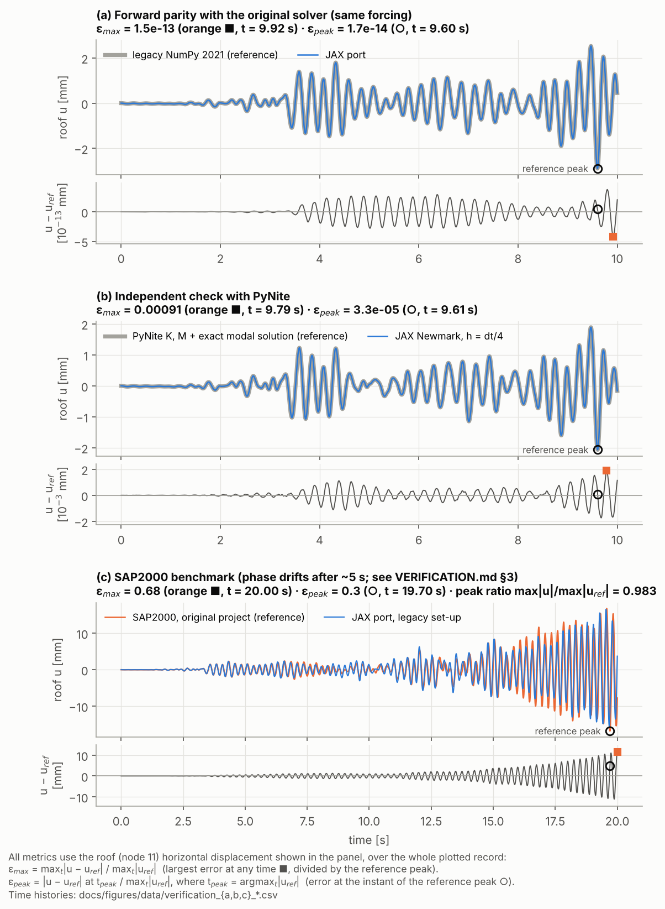
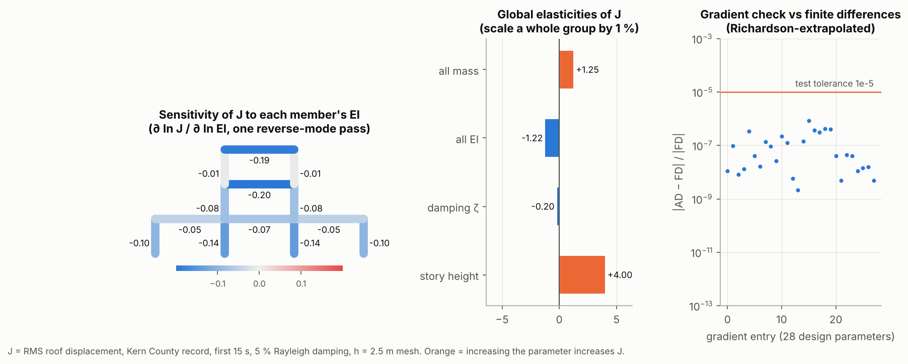
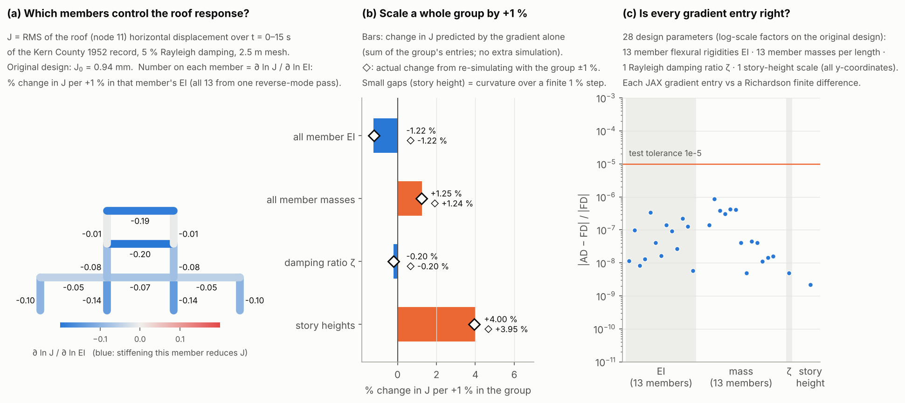

# Demo: porting a 2021 NumPy dynamics solver to a verified, differentiable JAX solver

**Researcher:** Gaoyuan Wu · **Tool:** Claude Code (cloud session) · **Model:** _[fill in]_ · **Reasoning effort:** _[fill in]_ · **Work:** November 13, 2026 · **Result:** [`jax-migration` branch](https://github.com/GaoyuanWu/NumericalAlgorithms4StructuralDynamics/tree/jax-migration)

**Task:** port my first-year grad-school course project (2D frame finite elements with four time integrators, NumPy, 2021) to JAX. The port had to reproduce the old forward results, add gradients, and prove both against external references. A differentiable solver enables sensitivity analysis and gradient-based design, but only if I can trust it.

This example follows the actual user requests. The prompts are quoted verbatim. Results summarize the agent's replies and repository changes, not a rerun. The before/after figures are the actual files from the session's commits.

## 1. What I wanted

The old code was plain NumPy: Python loops, hard-coded Windows paths, no tests, and no gradients. I wanted a JAX version that gives the same answers, is checked against an independent open-source solver, gives gradients I can trust, and shows the structure vibrating under an earthquake.

I supplied the repository, named the references, and pointed to this playbook. The agent did the reading, porting, testing, debugging, plotting and write-up. My role was to judge whether the evidence actually showed what it claimed.

## 2. Inputs and the original prompt

**Input:** [the original 2021 repository](https://github.com/GaoyuanWu/NumericalAlgorithms4StructuralDynamics/tree/f2d2b60). It contains the mesh, element matrices, boundary conditions, four integrators (Newmark-β, Wilson-θ, Bathe, SSP-RK3), a 3-story frame study, a 1952 Kern County ground-motion record, and a SAP2000 result for comparison.

**Prompt source:** verbatim (the single message that started the session)

> Our research group is doing a AI workshop tomorrow where each member uses a demo to demonstrate what is good/bad practice of agentic workflow.
>
> I'd like to use my this final project repo for numerical algorithms class i took in first year grad school from 5 years ago, which is an old, non-differentiable dynamics Python solver of structures.
>
> I'd like to show a demo where I use CLAUDE to adapt it to a jax and differentiable solver, with the exact forward ability, and additional backward capability. With checks against open-source solver PyNite (forward), and gradient check using finite difference. Visuals would be great to show how structures vibrate under ground motions. Open a new branch called jax-migration. Everything tested online.
>
> In addition to **code development**, Review the example and guideline of such demo provided by the PI: "https://github.com/SOLARIS-JHU/solaris-agentic-research", so that this code development procedure becomes a new example by me. Record this session, of what prompts that helped, did not help much.

**Observed result:** in one pass the agent:

- ported the solver into a new package;
- wrote 43 automated tests, run by GitHub Actions on every push;
- made an earthquake animation, a verification figure and a sensitivity figure;
- wrote a first version of this page.

The original code was kept untouched as the test reference.

Naming *external* checks (PyNite, finite differences) made every mismatch something to explain rather than a tolerance to relax. The agent reported four findings I would not have looked for:

- **A bug in my 2021 code.** The earthquake record was sometimes read one sample late, because `int(t/dt)` and `t % dt` disagree when `t/dt` rounds up. This changed the response by up to 6.7 % of the peak over the first 5 s. The agent did not copy the bug into the port. It defined "exact" as *same algorithm, same input*, which agrees to 1.5e-13, and flagged that definition for me to approve.
- **A compiler pitfall in its own port.** Inside compiled JAX, the same `floor`/`mod` pair disagreed at different steps, which caused a 2 % mismatch on the first run. It was found by bisecting to a single time step.
- **The SAP2000 benchmark drifts out of phase** after about 5 s, while PyNite agrees to 0.09 %. The agent tested hypotheses and found that a 0.5 % period difference explains it. It chose *not* to tune the model to SAP2000 and recorded the explanation as unverified.
- **The first gradient check failed because of the finite differences, not the gradient.** A step-size study showed round-off for some parameters and truncation for others; Richardson extrapolation fixed it.

[Full prompt and assessment](PROMPTS.md#p01-scope-and-acceptance-criteria) · [What the agent did, step by step](PROMPTS.md#appendix-what-the-agent-did-after-p01-agent-summary-in-order).

**Lesson:** acceptance criteria that point to *independent* references are the most valuable part of a coding prompt. What the prompt left open was what "exact" means, which tolerances apply, and what the figures should prove. That is where my follow-ups came in.

## 3. The prompts that changed the result

All 43 tests passed before each of these follow-ups. The problems were in what the figures *communicated*, which no test checks.

### A. "What does the peak mean?": define every number on a figure

**Actual user message:**

> For the verification image `docs/figures/verification.png`, what does the peak mean?\
> i) did you mean the peak error?\
> ii) or did you mean the error when the roof's displacement goes to the peak.\
> Fix the ambiguity.
>
> It might also be helpful to output .csv files that record time history of what you plotted for different solver/setup.

| Before | After |
|---|---|
|  |  |

**What changed:**

| | Before | After |
|---|---|---|
| Metric in the titles | "max error 1.5e-13 **of peak**". This meant neither of my two readings: it was the largest error at *any* time divided by the reference peak. | Two named metrics, each with the time it occurs: **ε_max** (largest error at any time) and **ε_peak** (error at the instant of the reference peak). A footnote gives both formulas. |
| Panel (a) | The number was computed over **all DOFs**, while only the roof was plotted. | Computed on the plotted roof DOF. |
| SAP2000 panel | "peak ratio 0.983", which reads as good agreement. | Peak ratio 0.983 **and** ε_peak = **30 %**. The peaks are similar in size but occur at different times because of phase drift. |
| Error visibility | Overlaid curves only; a 1e-13 error is invisible. | An error-vs-time strip under each panel, with both metric instants marked. |
| Raw data | None. | Every plotted history as a CSV, with the full setup in its header lines. |
| Rest of the docs | "of peak" used loosely throughout. | A notation section in the verification report; every "of peak" now names its metric and whether it covers the roof or all DOFs. |

**Lesson:** a careful domain-expert reading of one label found an ambiguity, a mismatch between what was computed and what was plotted, and a misleadingly good-looking number (0.983 hid a 30 % error at the peak). Ask for every summary number to be *defined*, and for the raw data behind every plot. [Full prompt](PROMPTS.md#p02-define-every-number-on-a-figure) · [Resulting change](https://github.com/GaoyuanWu/NumericalAlgorithms4StructuralDynamics/commit/cdb1028).

### B. "I have no idea what it verifies": make every panel explain itself

**Actual user message:**

> For gradient check figure,\
> i) left-hand side, define what J is next to the first sub-figure, not at subscript.\
> ii) middle, I have no idea what it verifies/outputs. Context needed.\
> iii) right hand side, what are the 28 design parameters, briefly mention what they are (in category groups)

| Before | After |
|---|---|
|  |  |

**What changed:**

| Panel | Before | After |
|---|---|---|
| (a) per-member sensitivity | The objective J was defined only in a footnote under the whole figure. | J is defined next to the panel (RMS roof displacement, 0–15 s, J₀ = 0.94 mm), together with what the number on each member means. |
| (b) group sensitivities | A bar chart titled "Global elasticities of J". It showed numbers but verified nothing. | The bars are labelled as the gradient's *prediction* for scaling a whole group by 1 %. **New check:** ◇ markers from re-running the simulation with each group scaled ±1 %. Three groups agree to within 0.02 percentage points; story height shows 4.00 % predicted vs 3.95 % simulated, explained as curvature over a finite 1 % step. |
| (c) gradient check | x-axis "gradient entry (28 design parameters)", unexplained. | The 28 parameters are listed by group (13 member EI, 13 member masses, damping ratio ζ, story-height scale), and the x-axis is grouped the same way. |

**Lesson:** the agent drew figures for someone who already knew the setup. "What does this panel verify?" is worth asking of every panel. Here it turned a display into an actual check, which also surfaced a real nonlinear effect. [Full prompt](PROMPTS.md#p03-make-every-panel-explain-what-it-verifies) · [Resulting change](https://github.com/GaoyuanWu/NumericalAlgorithms4StructuralDynamics/commit/f40b0ab).

### C. Package the result for this playbook

**Actual user message:**

> Now, update the `agentic-demo` folder to be ready to sent to the group repo, based on my new prompts earlier (what worked, how it changed the results - before v.s. after), following the template on the group repo.

**What changed:**

- The agent re-read this playbook's template and worked example (both unchanged since its first read).
- It recovered the "before" figures from the session's commit history and rewrote this page around the follow-ups.
- It kept the [prompt log](PROMPTS.md) up to date.

**Lesson:** "record what helped" works best when the follow-ups are recorded *as they happen*. The agent added each prompt to the log in the same turn it acted on it, so nothing had to be reconstructed at the end. [Full prompt](PROMPTS.md#p04-package-the-example-for-this-playbook).

## 4. Result and lessons learned

**Final state** (all tests re-run by GitHub Actions on every push):

| Check | Result |
|---|---|
| Same algorithm and input as the 2021 code | ε_max = 1.5e-13 |
| PyNite: assembled matrices · static deflections · first 8 frequencies | ≤ 1e-10 · 1e-8 · 1e-8 |
| PyNite: 10 s earthquake history vs an exact modal solution | ε_max = 0.09 % |
| SAP2000 (original benchmark) | peak ratio 0.983; ε_peak = 30 % from phase drift (explained, not tuned away) |
| Gradients vs finite differences: 28 parameters × 4 integrators | ≤ 1e-5 (typically 1e-7) |
| Single-mass-spring closed form | expected convergence orders 2, 2, 2, 3 |

- **What worked:** naming independent references up front; keeping the old code untouched as a reference; asking the agent to measure and report bugs instead of silently fixing them; short, specific questions about one figure at a time.
- **What failed:** the first figures defined their numbers loosely ("of peak"); one metric did not match what was plotted; one panel verified nothing. None of this was caught by 43 passing tests. Earlier, the first parity run and the first gradient check failed; the agent diagnosed both instead of loosening tolerances.
- **What the researcher checked:** the metric definitions and that each number matches its curve; what each figure panel proves; that the sensitivity signs make physical sense (stiffer → less drift, heavier or taller → more). **Still to confirm:** that the 2021 interpolation behaviour is a bug and not intended, and that "exact" may mean same algorithm and input rather than bit-identical. The SAP2000 explanation (shear deformation) remains an unverified hypothesis.
- **Limitations:** linear elastic Euler–Bernoulli frames only; the explicit SSP-RK3 scheme is impractical on fine meshes; no memory checkpointing for long reverse-mode runs.

## 5. Try the workflow by prompting your agent

**Suggested reuse prompt (newly written, not an original quotation):**

> Port [legacy code] to [new framework]. Keep the original code untouched and use it as the reference. Forward results must match the original to [tolerance] for [cases]; if they cannot, find out why, measure the effect, and ask me before changing what "match" means. Cross-check against [independent open-source tool] at the level of matrices, a static case, eigenvalues, and one time history. Check gradients for every parameter against finite differences, and study the finite-difference step before blaming the gradient. Report every bug you find in the original code with its measured effect. Run all tests in CI. For every figure, define each number in it, say what each panel verifies, and export the plotted data as CSV. Render the figures and look at them before calling it done.

Then review the figures one at a time. Ask "what exactly does this number mean?" and "what does this panel verify?". For a 5–10 minute demo, show the original prompt, follow-up A with its before/after, and one judgment call you had to make (§2, the definition of "exact").

Optional: original records, code, and data

- [Prompt log with all four prompts and a session timeline](PROMPTS.md)
- [Verification report](https://github.com/GaoyuanWu/NumericalAlgorithms4StructuralDynamics/blob/jax-migration/docs/VERIFICATION.md): metric definitions, every check, and the bugs found in the 2021 code
- [Plotted time histories (CSV)](https://github.com/GaoyuanWu/NumericalAlgorithms4StructuralDynamics/tree/jax-migration/docs/figures/data)
- [JAX package](https://github.com/GaoyuanWu/NumericalAlgorithms4StructuralDynamics/tree/jax-migration/structdyn_jax) · [tests](https://github.com/GaoyuanWu/NumericalAlgorithms4StructuralDynamics/tree/jax-migration/tests) · [figure script](https://github.com/GaoyuanWu/NumericalAlgorithms4StructuralDynamics/blob/jax-migration/scripts/make_figures.py) · [CI runs](https://github.com/GaoyuanWu/NumericalAlgorithms4StructuralDynamics/actions/workflows/tests.yml)
- Commits: [initial port](https://github.com/GaoyuanWu/NumericalAlgorithms4StructuralDynamics/commit/de48845) · [follow-up A](https://github.com/GaoyuanWu/NumericalAlgorithms4StructuralDynamics/commit/cdb1028) · [follow-up B](https://github.com/GaoyuanWu/NumericalAlgorithms4StructuralDynamics/commit/f40b0ab)

[Back to the playbook](../../README.md) · [Getting started](../../GETTING_STARTED.md) · [Demo template](../../templates/DEMO_TEMPLATE.md)
