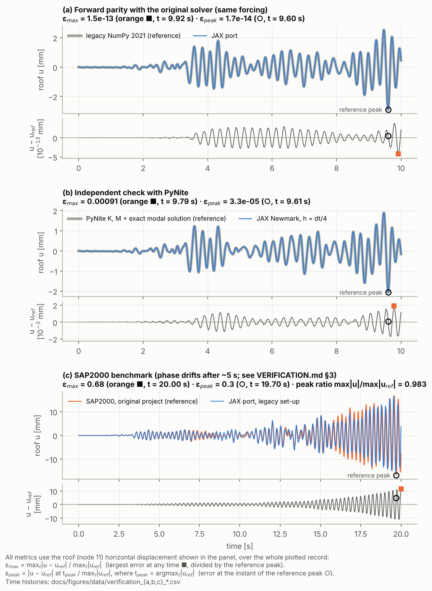

# Verification report: JAX port of the APC523 structural-dynamics solver

All numbers below come from the automated test suite (`pytest`, 43 tests,
run on every push by GitHub Actions) and from `scripts/make_figures.py`
(`docs/figures/metrics.json`). Float64 throughout. The plotted time histories
are in `docs/figures/data/*.csv` (one file per panel, setup described in the
header lines).

## Notation: what "error relative to the peak" means

All time-history comparisons use one of these metrics, with u the tested
solution and u_ref the reference, on the same time grid:

| Symbol | Definition | Meaning |
|---|---|---|
| **ε_max** | max_t \|u − u_ref\| / max_t \|u_ref\| | the largest error at *any* time, normalized by the reference peak. The two maxima generally occur at **different** times. |
| **ε_peak** | \|u − u_ref\| at t_peak / max_t \|u_ref\|, with t_peak = argmax_t \|u_ref\| | the error at the instant the reference reaches its peak |
| **peak ratio** | max_t \|u\| / max_t \|u_ref\| | compares peak magnitudes only; the peaks may occur at different times |

**Scope:** "roof" means the horizontal DOF of node 11, as plotted. "All DOFs"
means the max is also taken over every active DOF, for both numerator and
denominator; the legacy-parity tests assert this stricter form.

## 1. Forward: parity with the original solver

The original NumPy code (`Structure/`, `TimeIntegration/`) is **left
untouched** and imported by the tests as the frozen reference.

| Check | Result | Test |
|---|---|---|
| Mesh (node coordinates, connectivity, maps), h = 5, 2.5, 1, 0.5 m | identical | `test_legacy_parity.py::test_mesh_and_matrices` |
| Reduced K and M | ≤ 1e-13 of max entry | same |
| Newmark, Wilson-θ, Bathe, SSP-RK3 under functional load | ε_max (all DOFs) ≤ 1e-9 | `test_function_load` |
| Newmark, Wilson-θ, Bathe under the earthquake record, h = dt and dt/2, Rayleigh damping | ε_max (all DOFs) ≤ 1e-9; figure (a), roof: ε_max = 1.5e-13, ε_peak = 1.7e-14 | `test_implicit_ground_motion` |

"Same forcing" means: the legacy integrators are driven through their
functional-input branch with the same, consistent record interpolation used by
the JAX port. The reason is in §4 (legacy quirk 1).

## 2. Forward: independent open-source reference (PyNite)

The frame is rebuilt in **PyNite 3.x** (3D frame elements in the X–Y plane,
out-of-plane DOFs restrained). PyNite assembles its own matrices.

| Check | Result | Test |
|---|---|---|
| PyNite's assembled K, M vs ours (h = 2.5 m and 1 m) | ≤ 1e-10 of max entry | `test_pynite_forward.py::test_assembled_matrices_match_pynite` |
| Static: 1000 kN lateral roof load, every nodal DX/DY/RZ | rel 1e-8 | `test_static_lateral_load_matches_pynite` |
| First 8 natural frequencies (PyNite modal analysis) | rel 1e-8 | `test_natural_frequencies_match_pynite` |
| Earthquake time history (6 s, 5 % modal damping) vs **exact** Nigam–Jennings modal superposition on PyNite's K, M | roof ε_max: Newmark/Bathe < 0.5 %, Wilson < 2 %. Figure (b), Newmark, 10 s: ε_max = 0.09 %, ε_peak = 0.003 % | `test_earthquake_time_history_vs_pynite_modal` |

## 3. Forward: the original SAP2000 benchmark

The 2021 project compared against a SAP2000 modal time history of node 11
(`Structure/Disp.xlsx`). With the legacy set-up (h = 0.5 m, undamped):

* roof peak ratio: **0.983** (asserted within 2 %)
* roof ε_max over the first 5 s: 3.2 % (asserted < 4 %)
* roof over the full 20 s: ε_max = 68 %, ε_peak = 30 %, correlation 0.79, because of
  **phase drift** (not asserted). The peaks have similar size but the histories are out of phase by then.
  Our fundamental period (0.249 s) is about 0.5 % shorter than SAP2000's.
  Over roughly 80 cycles that accumulates to a visible shift. Scaling K by
  0.99 raises the correlation to 0.995, consistent with SAP2000's default
  inclusion of shear deformation (Euler–Bernoulli elements here). This is
  a *hypothesis*: the SAP2000 model file is not available, so we do **not**
  calibrate to it. The PyNite checks (§2) remain the authoritative reference.
* SAP2000 matches better with the full record (corr 0.86 vs 0.79 at K×1),
  suggesting SAP2000 used the full record, while the legacy script dropped
  the first sample (quirk 3).

## 4. Legacy quirks found during the port

| # | Quirk in the original code | Effect | Treatment in the JAX port |
|---|---|---|---|
| 1 | Record interpolation used `int(t/dt)` and `(t % dt)/dt` separately. When `t/dt` rounds up to an integer the two disagree, so it reads sample *i+1* instead of *i* (≈ 5 % of steps). | ε_max (all DOFs) = 6.7 % over the first 5 s (measured, h = 2.5 m) | Consistent `q = t/dt; i = floor(q); w = q − i`. A test pins the legacy effect and proves it is the *only* difference between the legacy record and function branches. |
| 1b | (In the port itself.) Under `jit`, XLA computes `t/dt` differently from Python, so a naive port of quirk 1 jumped one sample *ahead* at other steps: 2 % mismatch on the first parity run. | n/a | Fixed by the same consistent formula. Lesson: discrete `floor`/`mod` logic is not stable across compilers. |
| 2 | Ground-motion influence vector `r = ones` on **all** active DOFs (vertical translations and rotations too). | For this frame, roof peak ratio vs SAP2000 0.983 (all ones) vs 0.982 (horizontal r): negligible | Correct horizontal `r` by default; `jnp.ones(n)` reproduces legacy. |
| 3 | `pd.read_excel('GM.xlsx')` treated the first record value as a header. | Record shifted by one sample | `load_kern_county(legacy_drop_first=True)` reproduces it; default keeps all 15000 samples. |
| 4 | Newmark started from `a0 = 0` instead of equilibrium. | Small for quiescent starts | `a0=None` (equilibrium) by default; `a0=zeros` reproduces legacy. |
| 5 | Roller support counted as 2 constrained DOFs (`inact_num += 2`). | Wrong active-DOF count for rollers | Fixed (1 DOF). |
| 6 | Element angle from `arccos(...)`. | Infinite derivative for horizontal members, so gradients w.r.t. geometry would be NaN/inf | Direction cosines; test asserts finite, FD-consistent geometry gradients. |
| 7 | Hard-coded Windows `sys.path`; Bathe docstring says "Wilson". | Cosmetic | Legacy files untouched (kept as reference). |

## 5. Backward: gradients

Parameters (28): per-member log-scale of EI (13) and mass (13), the Rayleigh
damping ratio (fitted at modes 1–2, so the eigenvalue derivative is in the
chain), and a story-height scale (via nodal coordinates).

| Check | Result | Test |
|---|---|---|
| Newmark, all 28 parameters, objectives RMS / soft-peak / peak roof displacement | ≤ 1e-5 rel (figure: 4e-9) | `test_gradients.py::test_newmark_gradients_all_parameters` |
| Bathe, Wilson-θ, SSP-RK3, all 28 parameters | ≤ 1e-5 rel | `test_other_integrators_gradients` |
| Forward mode (`jacfwd`) = reverse mode (`jacrev`) for the full roof history | ≤ 1e-10 | `test_forward_and_reverse_mode_agree` |
| Geometry gradient finite (legacy quirk 6) | pass | `test_gradient_wrt_horizontal_beam_coordinates_is_finite` |

Finite differences use central differences with **Richardson extrapolation**
(ε = 1e-4, ε/2). A step study showed plain FD is round-off-limited for the
stiffness parameters (error grows as 1/ε) but truncation-limited for the
height parameter (grows as ε²). No single plain step serves both, so the
first gradient check failed at 1.4e-5. That was an FD artefact, not an AD error.

## 6. Scheme accuracy

SDOF under harmonic load against the closed form (`test_sdof_analytic.py`).
The observed orders are 2 (Newmark, Bathe, Wilson-θ) and 3 (SSP-RK3), as
expected.

## Not verified / limitations

* Linear elastic, small displacement, Euler–Bernoulli elements only (as in the original code).
* SSP-RK3 is explicit: the axial modes make it impractically restrictive on fine meshes (as in the original study).
* The SAP2000 phase-drift explanation (shear deformation) is a hypothesis, not a verified fact.
* Reverse-mode memory grows linearly with the number of time steps; no checkpointing is implemented.
